# TP2 — JPA / Hibernate : Gestion des salles

## Screenshots

### 1. Structure du projet

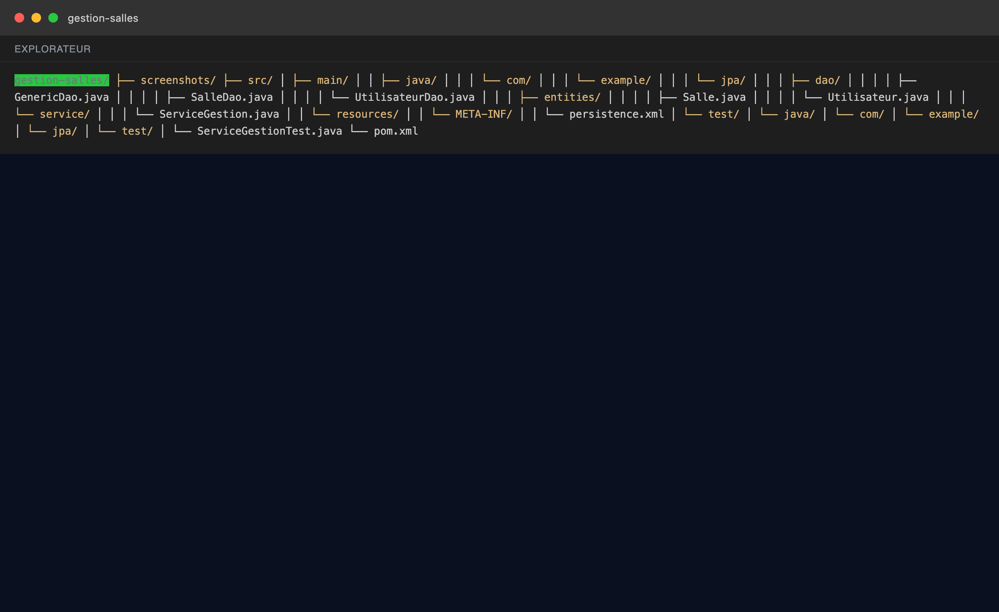

### 2. `pom.xml`

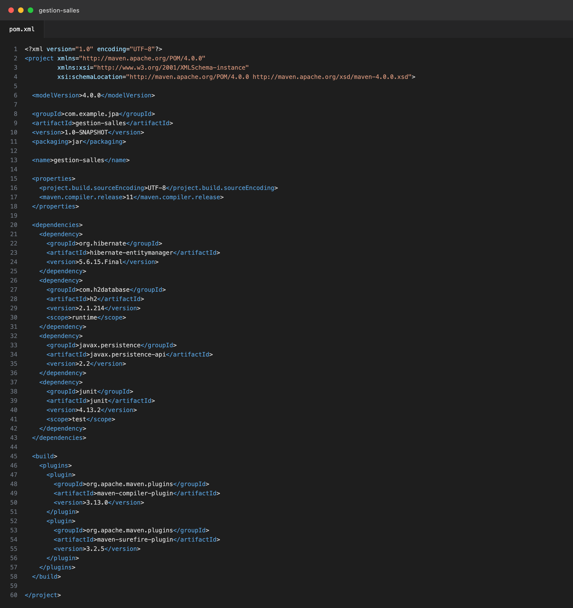

### 3. `persistence.xml`

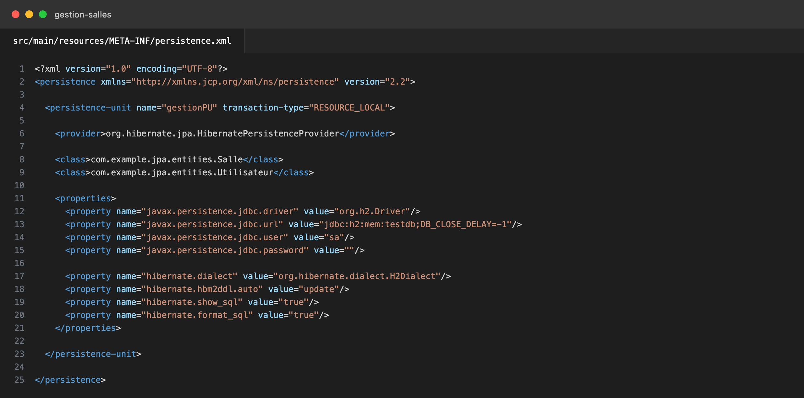

### 4. Entité `Salle`

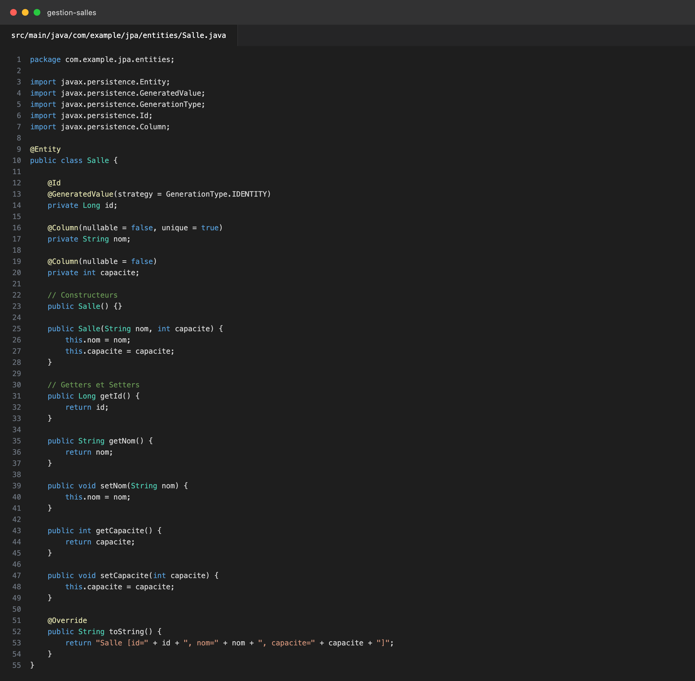

### 5. Entité `Utilisateur`

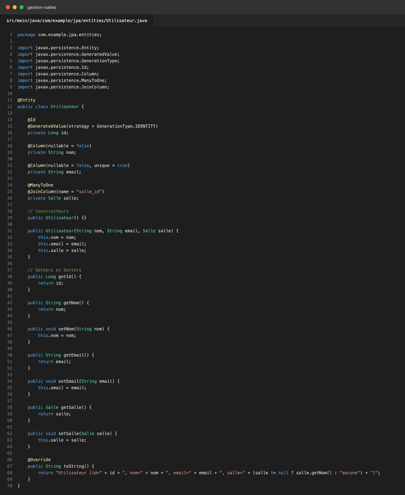

### 6. `GenericDao`

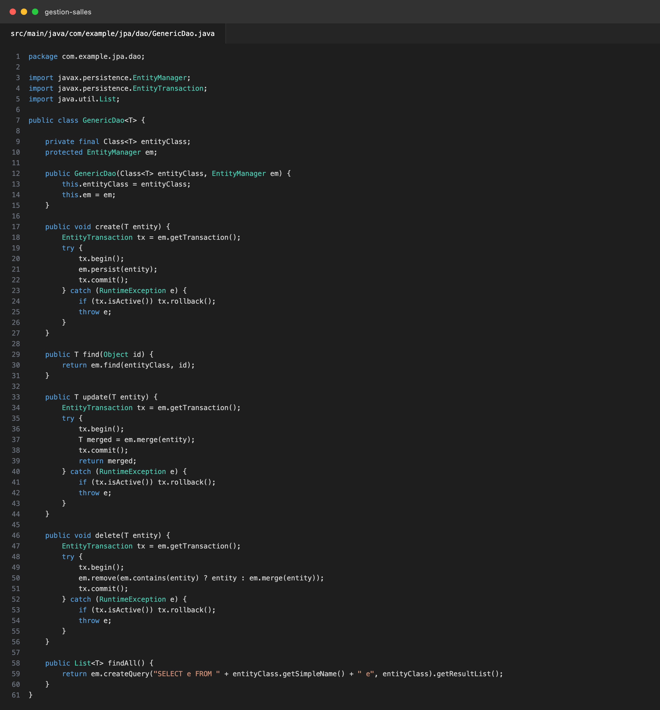

### 7. `SalleDao`

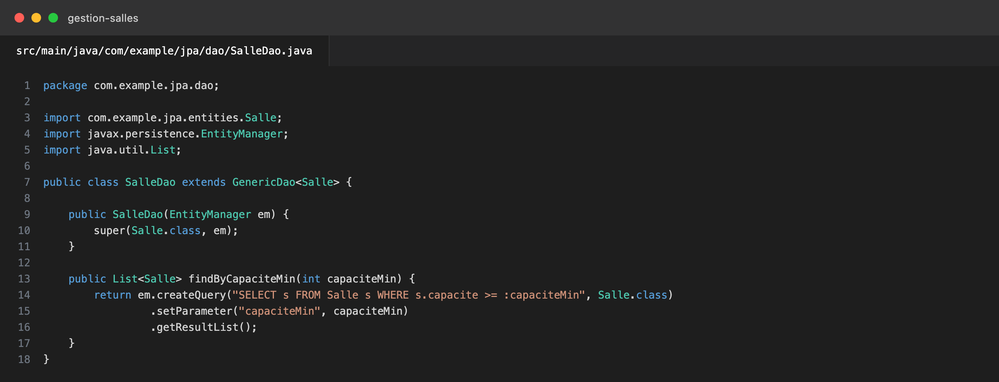

### 8. `UtilisateurDao`

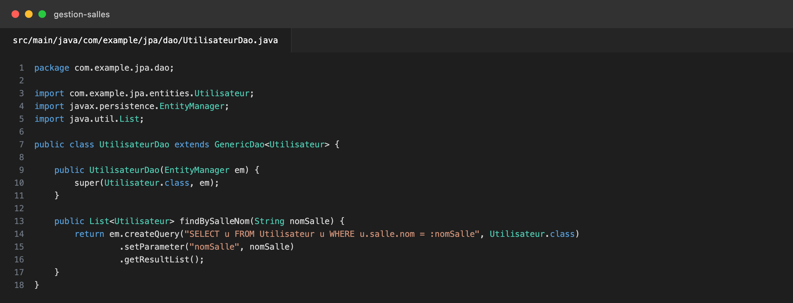

### 9. `ServiceGestion`

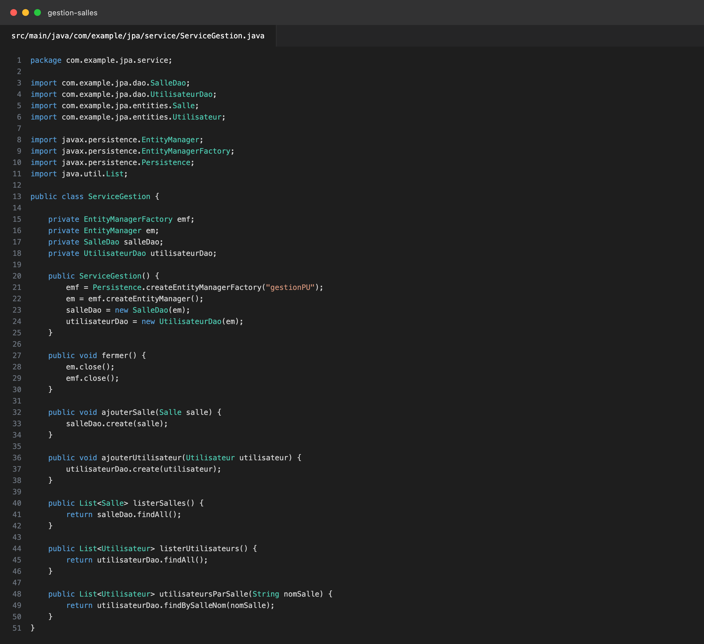

### 10. Test JUnit

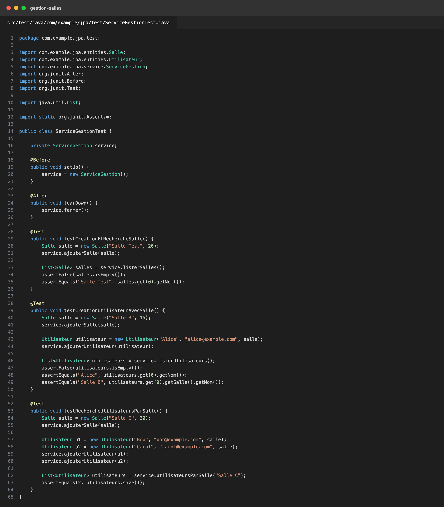

### 11. Exécution Maven

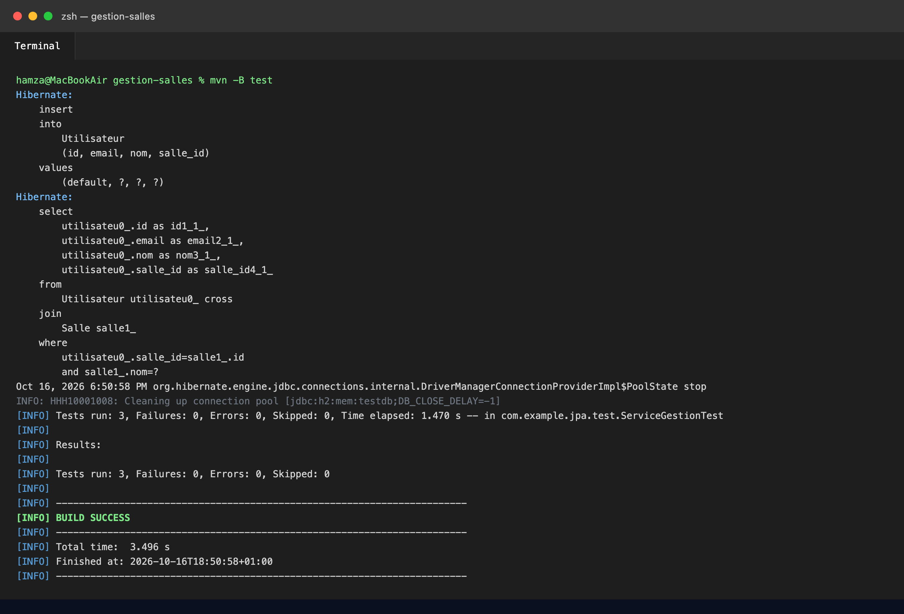
